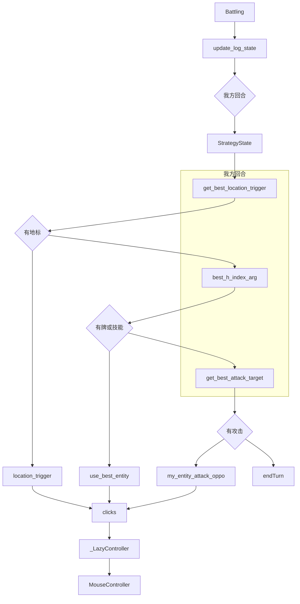
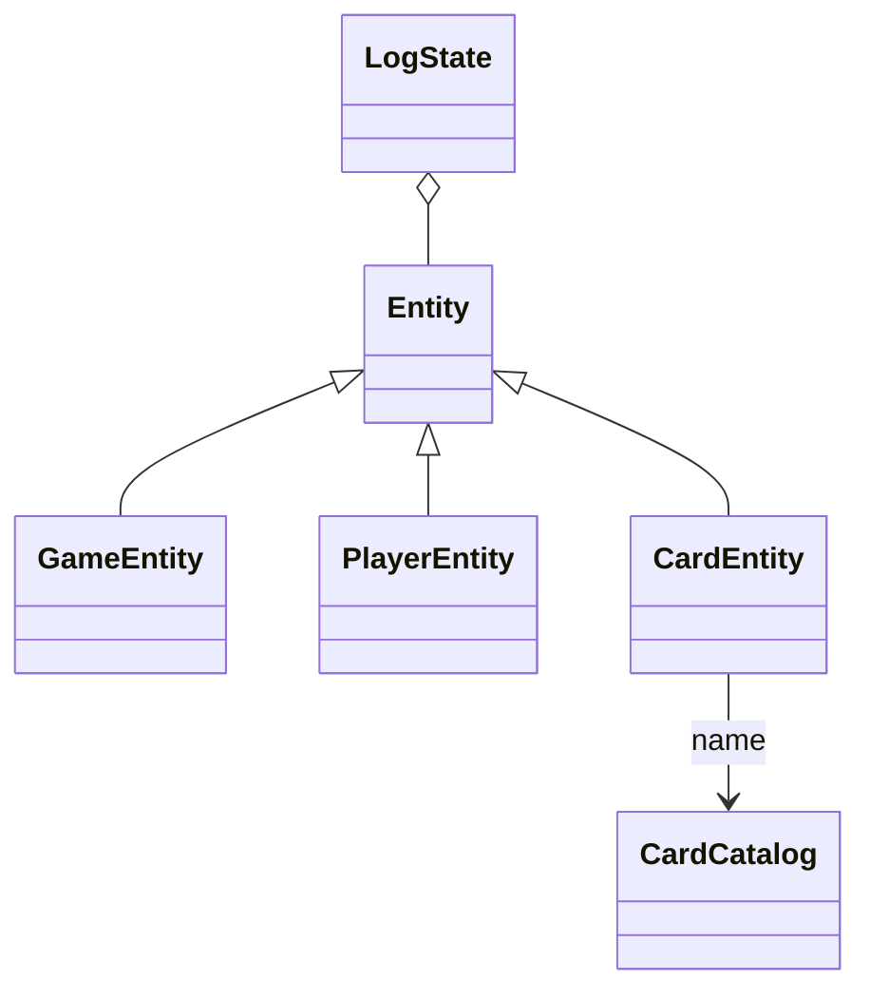
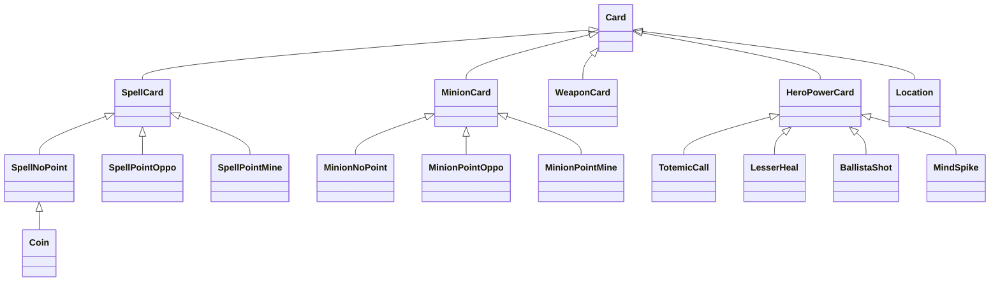
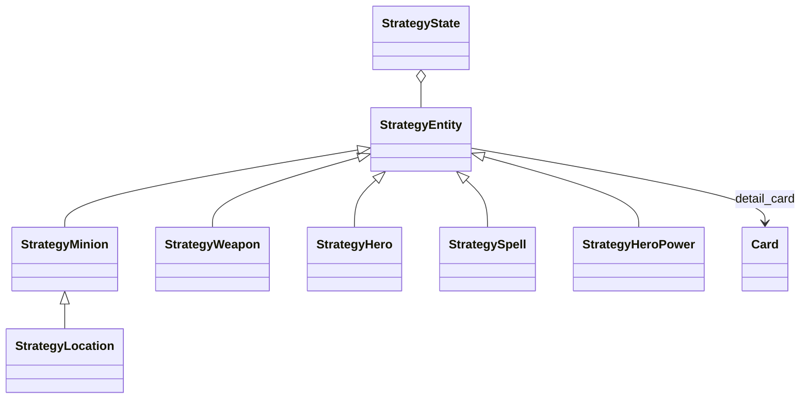
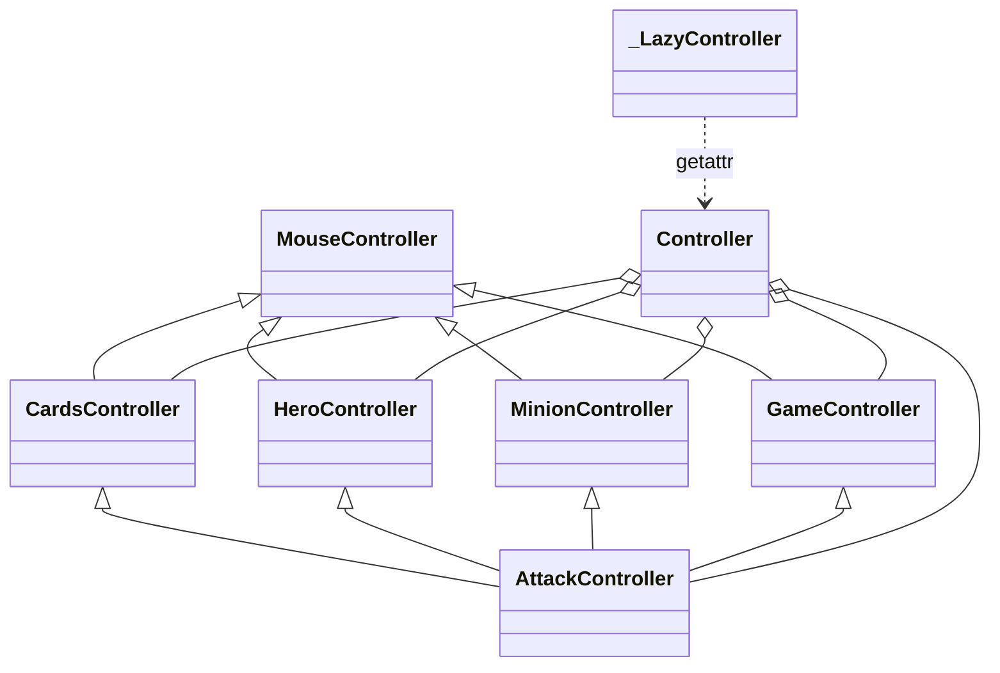

# AutoHS 类关系

一回合的决策在 `Battling` 里走完：读 `Power.log` 得到 `LogState`，包成 `StrategyState`，先触发地标，再给手牌和英雄技能打分，最后选攻击。出牌和攻击都通过 `clicks()` 碰到 `_LazyController`，再由 `MouseController` 点击。`figs/arch.png` 是上游画的同一条数据流：日志行、`LogInfoContainer`、`CardEntity`、`StrategyMinion`、行为决策、点击。

依赖由 `pyproject.toml` 和 `uv.lock` 管理，Python 3.13。仓库里没有 `requirements.txt`。

导入 `autohs` 不会打开界面、读屏、下载 `cards.json`，也不会构造 `MouseController`。`controller` 的类型是 `_LazyController`，访问属性时才创建 `Controller`。

## 1 我方回合先触发地标，再评分，再攻击



`update_log_state` 用 `log_iter_func` 读最新会话的 `Power.log`。`parse_line` 把一行收成 `LineInfoContainer`，`update_state` 写进 `LogState`。`StrategyState` 构造时用 `generate_strategy_entity` 把 `CardEntity` 包成对应的 `StrategyEntity`。

地标优先，因为赎罪教堂可以抽牌。`best_h_index_arg` 先看手牌，再看四个手写英雄技能。`index == -1` 是技能，`-2` 是不出牌。没有更高分时才 `get_best_attack_target`。`my_index == -1` 是英雄攻击，`-2` 是不攻击，然后结束回合。

`detail_card is None` 时，只有没有战吼的随从用 `MinionNoPoint` 评分。法术、武器和带战吼的随从记「无法评判」，得分留在 0。`use_card` 在没有手写行为时仍调用 `MinionNoPoint.use_with_arg`。英雄技能只认「次级治疗术」「图腾召唤」「稳固射击」「心灵尖刺」。

界面状态由 `AutoHS_automata` 分发：选英雄、匹配、留牌、战斗、结算、回主菜单、错误处理。这些是函数，不是类。`LoadingScreen.log` 由 `parse_line_loading_screen` 读。没有 LoadingScreen 配置时，`get_state` 改走 `vision/recognition.py` 的模板匹配。

## 2 继承

日志实体：



出牌行为。`behaviors/detail.py` 里 51 个手写子类继承下面这些基类，不各占一个文件。



策略实体。地标占随从格子，所以 `StrategyLocation` 继承 `StrategyMinion`。



点击。`AttackController` 同时继承四个控制器，专门打出随从攻击和技能指向。`Controller` 持有 `cards`、`game`、`hero`、`minion`、`attack`。



`behaviors` 和 `strategy` 在模块顶层不导入 `execution`。`clicks()` 在函数内部导入 `controller`。`GameController.enterHS` 在函数内部导入窗口函数。AppKit、Quartz、cv2、pyautogui、mss、requests、psutil 都在函数内部或第一次访问 `controller` 属性时加载。

## 3 类按日志、行为、策略、点击四层分工

| 类 | 职责 |
| :--- | :--- |
| `AutoHSConfig` | 保存对局上限、安装路径、投降开关，以及当前分辨率对应的坐标表。`save_config` 和 `load_config` 读写 `configs.json` |
| `LiveClickCoordinates` | 点击时读取已经绑定的坐标表。表是空的就抛 `RuntimeError` |
| `SkillType` | 区分英雄技能打英雄、我方随从还是对方随从 |
| `PositionIndex` | 一个点击目标的种类和序号 |
| `PositionIndexType` | 手牌、随从、英雄、英雄技能这几类位置 |
| `CardCatalog` | 按卡牌 id 给名字、种族和法术派系。第一次查询才读本地 JSON。未知 id 抛 `KeyError`。下载只走 `download_and_load` |
| `LineInfoContainer` | 一行日志解析出的类型和字段 |
| `LogInfoContainer` | 一次读取攒下的多行，或一个错误容器 |
| `LogState` | 用 entity id 记下对局、双方玩家和每张牌的标签，并回答回合、胜负、手牌数 |
| `Entity` | 一个实体的标签字典 |
| `GameEntity` | 对局实体 |
| `PlayerEntity` | 玩家实体 |
| `CardEntity` | 带 card id 的牌。`name` 查询 `CardCatalog` |
| `Card` | 手写行为的共同接口：留牌、评分、按参数打出 |
| `SpellCard` | 法术这一支 |
| `SpellNoPoint` | 不指定目标的法术 |
| `SpellPointOppo` | 指向对方的法术 |
| `SpellPointMine` | 指向我方的法术 |
| `MinionCard` | 随从。用费用和身材算基础分，再加战吼分 |
| `MinionNoPoint` | 不指定目标的随从，下到空位 |
| `MinionPointOppo` | 战吼指向对方 |
| `MinionPointMine` | 战吼指向我方 |
| `WeaponCard` | 装备武器 |
| `HeroPowerCard` | 英雄技能 |
| `Coin` | 幸运币。先看花掉它能不能让另一张牌更值 |
| `Location` | 地标的触发 |
| `TotemicCall` | 图腾召唤 |
| `LesserHeal` | 次级治疗术 |
| `BallistaShot` | 稳固射击 |
| `MindSpike` | 心灵尖刺 |
| `StrategyEntity` | 从日志实体抽出费用、区域、过载和是否我方。`detail_card` 查 `ID2CARD_DICT` |
| `StrategyMinion` | 随从的攻防、嘲讽、能否攻击，以及受伤或治疗后的分数变化 |
| `StrategyWeapon` | 武器的攻击和耐久 |
| `StrategyHero` | 英雄的生命、护甲、攻击，以及能否被法术、技能、随从指向 |
| `StrategySpell` | 手牌里的法术 |
| `StrategyLocation` | 占随从格子的地标。攻击和指向接口按地标关掉 |
| `StrategyHeroPower` | 英雄技能。`detail_hero_power` 只返回上面四个手写类 |
| `StrategyState` | 整回合评分和执行：地标、手牌、技能、攻击。`use_card`、`use_best_entity`、`my_entity_attack_oppo` 都是这个类的方法 |
| `MouseController` | `pyautogui` 的移动、点击、右键和拖拽 |
| `CardsController` | 选手牌、打出手牌、换牌、把随从放到战场 |
| `HeroController` | 点英雄、点技能、英雄打脸 |
| `MinionController` | 按场上数量算随从坐标并点中 |
| `GameController` | 匹配、结束回合、投降、表情、确认、进入炉石 |
| `AttackController` | 随从打随从、随从打脸、英雄打随从、技能指向目标 |
| `Controller` | 持有上面五个控制器 |
| `_LazyController` | 第一次访问属性时才构造 `Controller` |
| `_Screen` | FSM 沿用 `window_utils` 这个名字调用识图和窗口函数。第一次用到才加载对应模块 |

`ID2CARD_DICT` 有 69 个键，在 `behaviors/registry.py`。键包括幸运币、四个英雄技能，以及同一张牌的多个 id。51 个手写子类都在 `behaviors/detail.py`：

指向对方的法术是 `LightingBolt`、`Hex`、`HolySmite`、`ShadowWordDeath`、`Hysteria`、`MindBlast`。不指定目标的法术是 `LightningStorm`、`FeralSpirit`、`WaveOfApathy`、`DevouringPlague`、`HolyNova`、`ShadowWordRuin`、`AgainstAllOdds`、`SoulMirror`、`RaiseDead`、`Acupuncture`、`MindShatter`。指向我方的法术是 `Apotheosis`。指向对方的随从是 `FireElemental`、`ElvenArcher`、`DefiasCleaner`。指向我方的随从是 `EarthenRingFarseer`。武器是 `StormforgedAxe`。地标是 `ChurchOfAtonement`。其余随从不指定目标：`MindControlTech`、`AzureDrake`、`Onyxia`、`Abomination`、`StampedingKodo`、`BloodKnight`、`DoomSayer`、`ArmorVendor`、`BonechewerBrawler`、`DeathsHeadCultist`、`OverconfidentOrc`、`RuststeedRaider`、`TaelanFordring`、`CairneBloodhoof`、`MutanusTheDevourer`、`BloodOfGhuun`、`PatchesThePirate`、`VoidtouchedAttendant`、`TreasureMerchant`、`MindrenderIllucia`、`ShipSurgeon`、`ShadowBomber`、`TwilightDeceptor`、`CathedralOfAtonement`、`PaperCranes`、`DarkbishopBenedictus`、`FrenziedFelwing`。

## 4 解析、跟读和状态机是函数

| 函数 | 职责 |
| :--- | :--- |
| `parse_line` | 解析一行 `Power.log`。认不出就返回 `None` |
| `parse_line_loading_screen` | 解析 `LoadingScreen.log` 的界面切换 |
| `log_iter_func` | 跟读一个日志文件。目录或文件不存在时产出错误容器并返回，不创建空文件。文件存在时会一直读 |
| `update_state` | 按行类型刷新 `LogState` |
| `generate_strategy_entity` | 按 `CARDTYPE` 构造 `StrategyMinion`、`StrategyWeapon`、`StrategyHero`、`StrategySpell` 或 `StrategyHeroPower` |
| `clicks` | 返回懒加载的 `controller` |
| `bind_screen` | 只在 1920×1080 和 2560×1440 时绑定坐标表，其他分辨率把表设为 `None` |
| `get_state` | 用八张模板图判断当前界面 |
| `images` | 第一次调用时读取八张模板 PNG |
| `AutoHS_automata` | 按界面状态调用选英雄、匹配、留牌、战斗、结算和错误处理 |

窗口、截图和 Darwin 辅助功能都是函数：`desktop/macos.py`、`desktop/windows.py`、`desktop/window_service.py`、`desktop/capture.py`、`desktop/screen.py`。坐标数字表在 `desktop/coordinates.py`。`repo_root()` 在 `paths/root.py`。安装路径在 `paths/install.py`。

## 5 文件

```text
src/autohs/
├── config.py
├── constants.py
├── positions.py
├── paths/install.py
├── paths/root.py
├── catalog/lookup.py
├── catalog/storage.py
├── catalog/download.py
├── logs/events.py
├── logs/power.py
├── logs/loading_screen.py
├── logs/state.py
├── logs/reader.py
├── behaviors/basic.py
├── behaviors/detail.py
├── behaviors/hero.py
├── behaviors/registry.py
├── strategy/entities.py
├── strategy/state.py
├── execution/controller.py
├── execution/mouse.py
├── execution/cards.py
├── execution/game.py
├── execution/hero.py
├── execution/minion.py
├── execution/attack.py
├── desktop/coordinates.py
├── desktop/screen.py
├── desktop/macos.py
├── desktop/windows.py
├── desktop/capture.py
├── desktop/window_service.py
├── vision/templates.py
├── vision/recognition.py
├── infrastructure/logging.py
├── infrastructure/game_log_config.py
├── app/bootstrap.py
├── app/gui.py
├── app/fsm.py
└── assets/templates/
```

根目录保留 `main.py`、`scripts/`、`demo/`、`figs/` 和 `LICENSE`。`main.py` 只在调用 `main()` 时进入 `app/bootstrap.py`，再进入 `run_gui()`。`demo/` 不进 wheel。`cards.json` 不进包。八张识图 PNG 在 `assets/templates/`。`figs/` 留下 `arch.png`、`gui.png`、`log.png`。
